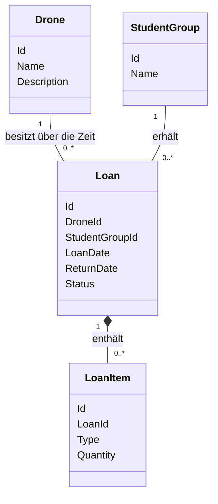

# Domänenmodell und DDD

## Quelle und Zweck

Grundlage ist der vollständig gelesene
[Projektauftrag](source/INF4_SYP_19_Projektauftrag_Drohnenverwaltung.pdf),
insbesondere PDF-Seiten 10–12 und 14–18. Die zugehörigen prüfbaren Anforderungen
stehen in [requirements.md](requirements.md). Dies ist ein fachliches Modell,
noch kein Datenbankschema oder implementiertes Klassenmodell.

DDD (Domain-Driven Design) bedeutet, die Software an der fachlichen Aufgabe
und einer gemeinsamen Sprache auszurichten. Eine Entity hat eine eigene,
über Änderungen hinweg beständige Identität: Eine Drone bleibt beispielsweise
dieselbe Drone, wenn sich ihre Beschreibung ändert. Die Id bezeichnet diese
Identität. Datentypen und Vergabeverfahren der Ids sind noch offen.

## Gemeinsame Sprache und Attribute

Die vier Entities und die Attributnamen entsprechen Seite 11. Die Bedeutungen
werden durch Seiten 10 und 14–18 erläutert. Zusätzliche persistierte Attribute
werden nicht eingeführt.

| Entity | Bedeutung | Attribute laut PDF |
| --- | --- | --- |
| Drone | Ein verwaltetes Fluggerät, das ausgeliehen werden kann. | Id, Name, Description |
| StudentGroup | Eine Schülergruppe, die ausleiht und verantwortlich ist. | Id, Name |
| Loan | Eine Loan verbindet genau eine Drone mit genau einer StudentGroup, Zeit und Zubehör. | Id, DroneId, StudentGroupId, LoanDate, ReturnDate, Status |
| LoanItem | Eine Zubehörposition innerhalb genau einer Loan. | Id, LoanId, Type, Quantity |

| Attribut | Fachliche Bedeutung |
| --- | --- |
| Drone.Id | Identität der Drone. |
| Drone.Name | Bezeichnung, z. B. TELLO-07. |
| Drone.Description | Freitext, z. B. SSID oder Schadensnotiz; kein eigenes SSID-Feld und keine Schadenslogik. |
| StudentGroup.Id | Identität der StudentGroup. |
| StudentGroup.Name | Bezeichnung, z. B. Group 3. |
| Loan.Id | Identität der Loan, die auch nach Rückgabe erhalten bleibt. |
| Loan.DroneId | Bezug auf genau eine Drone. |
| Loan.StudentGroupId | Bezug auf genau eine StudentGroup. |
| Loan.LoanDate | Datum der Loan. |
| Loan.ReturnDate | Datum der Rückgabe; vor Rückgabe liegt fachlich noch keines vor. Die technische Darstellung ist offen. |
| Loan.Status | Active oder Returned; Rückgabe führt von Active zu Returned. |
| LoanItem.Id | Identität der Zubehörposition, nicht eines einzelnen Akkus oder Propellers. |
| LoanItem.LoanId | Zugehörigkeit zu genau einer Loan. |
| LoanItem.Type | Battery oder Propeller. |
| LoanItem.Quantity | Ganze Zahl größer oder gleich 0. |

Die Drone-Verfügbarkeit Available oder Loaned ist eine **abgeleitete Angabe**,
kein zusätzlich unabhängig gepflegtes Attribut im PDF-Modell. Sie ist Loaned,
wenn eine Active Loan für die Drone besteht, andernfalls Available. Loan.Status
beschreibt dagegen den Lebenszyklus einer konkreten Loan. Es handelt sich um
zwei unterschiedliche Aussagen; Drone-Verfügbarkeit wird nicht separat geändert.

## Beziehungen und Mermaid-Domänenmodell

- Eine Drone kann über die Zeit 0 bis viele Loans haben, gleichzeitig aber höchstens eine Active Loan.
- Eine StudentGroup kann 0 bis viele Loans haben. Eine zusätzliche Begrenzung auf eine aktive Loan pro StudentGroup ist nicht vorgegeben.
- Jede Loan gehört zu genau einer Drone und genau einer StudentGroup.
- Jede LoanItem gehört zu genau einer Loan und hat keine unabhängige fachliche Existenz. Sie verweist nicht auf eine Drone.
- Das Modell lässt 0 bis viele LoanItems pro Loan zu: Mengen dürfen 0 sein und eine Mindestzahl von Positionen ist nicht festgelegt. Ob Nullmengen durch fehlende Positionen repräsentiert werden, bleibt offen.

Die Kardinalität Drone–Loan beschreibt auch die Historie. Sie erlaubt keine
mehreren gleichzeitig aktiven Loans: Diese zeitliche Bedingung ist DR-01.
Die Komposition bedeutet fachliche Zugehörigkeit; sie fordert keine Löschung.
Gerade zurückgegebene Loans und ihre LoanItems müssen erhalten bleiben.

## Entities, Werte und Aggregate

Alle vier Begriffe werden hier entsprechend den Id-Attributen auf Seite 11
als Entities beschrieben. Battery und Propeller sind Werte von LoanItem.Type;
Quantity ist ein Mengenwert. Es gibt keine Entity für einzelne Zubehörgeräte.
Ein Value Object beschreibt einen Wert ohne eigene Identität. Ein LoanItem wird
hier wegen seiner vorgegebenen Id nicht zu einem Value Object umgedeutet.

Loan ist laut PDF die zentrale Entity. Als fachliche Modellierungsentscheidung
wird Loan mit ihren LoanItems als Aggregat betrachtet: Die Positionen werden
im Kontext ihrer Loan verwaltet und dauerhaft mit ihr aufbewahrt. Ein Aggregat
fasst zusammengehörige fachliche Daten und Regeln zusammen; Loan bildet dessen
Einstiegspunkt. Drone und StudentGroup bleiben eigenständig referenzierte
Entities. Das PDF legt keine Repository-Klassen oder technischen Transaktionsgrenzen
fest. Insbesondere muss die Regel gegen doppelte aktive Loans auch über mehrere
Loan-Aggregate hinweg im Backend durchgesetzt werden.

## Domain Rules

Domain Rules sind verbindliche fachliche Grenzen. Die folgenden sieben Regeln
entsprechen Seite 12; die Kennungen dienen nur der lokalen Nachverfolgbarkeit.

| Regel | Fachliche Bedingung | Requirements |
| --- | --- | --- |
| DR-01 | Je Drone höchstens eine Active Loan, auch bei gleichzeitigen Versuchen. | REQ-005 |
| DR-02 | Nur Available Drones können ausgeliehen werden. | REQ-004, REQ-005 |
| DR-03 | Rückgabe ändert Loan.Status von Active zu Returned; die Drone wird dadurch Available. | REQ-008 |
| DR-04 | Quantity ist ganzzahlig und ≥ 0; ungültige Mengen werden im Backend abgelehnt. | REQ-006 |
| DR-05 | Zurückgegebene Loans und ihre LoanItems bleiben dauerhaft erhalten, einschließlich Zuordnungen und Daten. | REQ-008 bis REQ-010 |
| DR-06 | Zubehör wird nur als Menge mit Type Battery oder Propeller geführt, ohne Einzelgeräteidentitäten. | REQ-006 |
| DR-07 | Drone-Verfügbarkeit folgt ausschließlich aus aktiven Loans: Active vorhanden → Loaned; sonst Available. | REQ-002, REQ-004, REQ-008 |

Bei einer Rückgabe werden nach Seite 18 nur Status und ReturnDate verändert.
Die Loan wird nicht gelöscht, LoanDate und LoanItems bleiben bestehen.
Das Backend enthält Geschäftslogik und Validierung; ein Angular-Formular allein
kann diese Regeln nicht absichern (Seiten 7–8). Eine konkrete Implementierung
wird erst später über OpenSpec geplant.

## Gegenprobe am Beispiel

Seite 18 zeigt eine Loan für Drone TELLO-07 und StudentGroup Group 3 am
19.08.2026 mit Status Active. Sie enthält zwei LoanItems: Battery mit Quantity 4
und Propeller mit Quantity 8. Die Drone ist daraus abgeleitet Loaned. Nach der
Rückgabe hat dieselbe Loan Status Returned und ein ReturnDate; die Drone ist
wieder Available. Die beiden LoanItems bleiben Teil der Historie.

## Out of Scope und offene Entscheidungen

Gemäß Seite 19: kein Login, keine Benutzerkonten oder Rollen, keine einzelnen
Akku-IDs oder sonstigen Zubehörgeräte-Identitäten, keine Reservierungen,
Schadensverwaltung, Rückgabedifferenzen, Auswertungen, Statistiken oder Exporte.
Die Freitextbeschreibung einer Beschädigung führt nicht zu einer weiteren
Statusausprägung. Die späteren Change-Request-Beispiele sind nicht Bestandteil
dieses Ausgangsmodells. Class, Members, ResponsibleStudent und SSID als eigenes
Feld werden nicht ergänzt.

Die offenen Punkte zu IDs, Validierung, Datum, Nullmengen, mehrfachen Positionen
und Rückgabe stehen vollständig in
[requirements.md](requirements.md#unklarheiten-und-noch-offene-entscheidungen).
Die Aggregatgrenze ist eine hier begründete Modellierungsentscheidung, keine
zusätzliche aus dem PDF zitierte Vorgabe.

Die frühere Definition „LoanItem ordnet Drone einer Loan zu“ wird korrigiert:
Im verbindlichen PDF liegt DroneId auf Loan; LoanItem enthält Type und Quantity.
Damit stimmen Modell, Requirements und Projektkonfiguration überein.

## Bestätigte Präzisierungen nach dem Spec-Review

Am 12.11.2026 wurden die fünf zuvor offenen Fragen vom Benutzer entschieden.
Die bisherigen offenen Punkte dokumentieren den PDF-Ausgangsstand. Verbindliche
Präzisierungen und Szenarien stehen im vorhandenen Change
[initial-drone-lending-system](../openspec/changes/initial-drone-lending-system/design.md):
Namen außen trimmen und 1–100 Zeichen, doppelte Namen mit Id unterscheiden;
automatische Kalendertage in Europe/Vienna, YYYY-MM-DD und ReturnDate null bei
Active; erneute Rückgabe 409 ohne Änderungen; Fehlervertrag 400/404/409 mit
Problem-JSON; Nullpositionen nicht speichern, fehlende Mengen als 0 anzeigen und
doppelte Zubehörtypen ablehnen. Diese Ergänzungen stammen aus der bestätigten
Review-Entscheidung, nicht aus zusätzlichen PDF-Vorgaben. Keine Funktion ist
damit implementiert.
